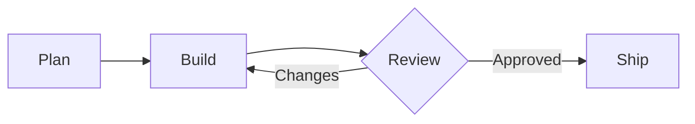

# Assistant message formatting

Assistant responses render GitHub-flavored Markdown: headings, bold, italic,
strikethrough, ordered and unordered lists, task lists, quotes, links, inline and
fenced code, and tables. Text is selectable. Wide code and tables scroll
horizontally inside the conversation. Code blocks show their language and a copy
button. Unknown languages and unfinished Markdown remain readable.

User, system, and tool messages remain literal. Message and conversation copy
actions preserve the original Markdown; code copy preserves the parsed code
content (including the Markdown parser's terminating newline). Stored history is
unchanged and receives formatting when reopened.

HTTPS links without credentials open in the browser. Local file links show
**Show file in Finder** and their path on hover. Clicking reveals the file in
its parent folder with the file selected; it does not open the file's application.
Unsupported destinations and failures show feedback in the message. Raw HTML is inert text;
HTML, JavaScript, shell commands, and React are never executed. Mermaid is
parsed and drawn natively; embedded click/href declarations are inert.

## File links

```markdown
[Source](lib/main.dart)
[Source at line 12](lib/main.dart#L12)
[Source at line and column](lib/main.dart:12:4)
[Absolute path](/Users/me/project/lib/main.dart)
[Filename with spaces](file:///Users/me/My%20Project/notes.txt)
```

Relative destinations resolve against the conversation's project folder, never
the app's working directory. Absolute paths and local `file:///` URLs (including
`file://localhost/`) are supported. Spaces, Unicode, and URL-encoded filenames
are preserved; encode literal `#` and `%` in filenames as `%23` and `%25`.
Line fragments such as `#L12`, `#L12C4`, and `#L12-L20` reveal the underlying file.
For `:line` and `:line:column` suffixes, an existing exact filename takes priority
because colons are legal in macOS filenames. Directory links select the directory
in its parent folder. Only explicit Markdown links are made clickable.

Missing files and unavailable project context show an error. Paths from remote
projects are not looked up on the local Mac; the message explains that the file
lives on the remote host. Network file hosts, executable URL schemes, query
strings on file links, and unsupported fragments are rejected. This behavior
does not change the HTTPS-only image-preview policy below.

## Static mockups and chart images

```markdown

```

Each image reserves a preview area with alt text. Click **Load image preview** to
fetch it; simply reading or reopening a message never fetches images. The button
shows the destination on hover. Loading contacts that server directly. Only HTTPS
PNG, JPEG, and static WebP are supported, with a 4 MiB download limit, a 4096-pixel
limit per dimension, an 8-megapixel decoded limit, and a 20-second request limit.
Redirects, animation, SVG, local files, assets, data URLs, and other resources are
unsupported. Failure leaves the reserved area in place with a retry button.
Previews are not persisted. No image generation is performed.

## Mermaid diagrams

Use a closed `mermaid` fence. Layout and painting use the MIT-licensed
[`mermaid_flutter` / `mermaid_core`](https://github.com/orestesgaolin/mermaid)
libraries, without a browser, network requests, or JavaScript:

````markdown

````

Flowcharts, sequence, state, class, entity-relationship, pie, and XY diagrams
are covered by the prototype tests. Other diagram types depend on the native
renderer and may differ from mermaid.js. Default colors and fonts follow Ditch's
current theme. Explicit node styles can still supply their own colors.

Inline diagrams reserve a 360-point viewport while loading and after rendering.
The diagram itself has no character-count, line-count, or canvas-dimension cap.
Scrolling over the preview scrolls the conversation. **Expand diagram** opens a
pan/zoom viewer with zoom controls and **Fit diagram**, using the same computed
scene rather than rerunning layout. Colors and fonts follow the app theme.

**Show source** replaces the diagram with selectable Mermaid source; **Hide
source** restores the cached diagram without rerendering. The block's **Copy as Markdown**
action includes the opening `mermaid` fence, source, and closing fence, using a
longer fence if necessary to preserve literal backticks. Whole-message copying
still preserves the original message. Diagram labels are available to screen
readers.

Parsing/layout run in cancellable background isolates, with at most two active
jobs. Exact Flutter font metrics are measured in short UI batches and returned
to the worker; no approximate-layout pass is displayed. The loading state has
**Cancel rendering**, and cancellation/errors offer **Retry diagram**. Source or
theme changes cancel obsolete work; late results cannot replace a newer diagram.
Unchanged messages retain their scene. Large diagrams can consume more time and
memory, but are not rejected merely for crossing a preset size threshold.

Only closed fences render. Invalid/unsupported syntax or invalid geometry show
an error and readable source. Embedded `%%{...}%%` configuration and YAML
frontmatter still remain code, so they cannot override the app theme or renderer
settings. This is a native Mermaid implementation, not a guarantee of full
mermaid.js compatibility. Regression fixtures are generated, including a nested
240-node graph exceeding all three former limits; no conversation history is
used.

## Native charts

Use a closed `ditch-chart` fence with JSON:

````markdown
```ditch-chart
{
  "title": "Weekly signups",
  "type": "bar",
  "labels": ["Mon", "Tue", "Wed"],
  "series": [
    {"name": "This week", "values": [12, 18, 15]},
    {"name": "Last week", "values": [9, 14, 13]}
  ]
}
```
````

`type` is `bar` or `line`. Charts use the MIT-licensed
[`fl_chart`](https://github.com/imaNNeo/fl_chart) renderer with Ditch theme colors,
grid lines, numeric axes, and hover values. Charts include category labels, series names, and all
numeric values as selectable, accessible text. Negative values and zero are
supported. There must be 1–48 labels and 1–4 series, with exactly one finite
numeric value per label in each series. Values must have absolute magnitude at
most 10^12. Titles, category labels, and series names are required, nonblank
strings of at most 80 characters.

## Color palettes

````markdown
```ditch-palette
{
  "title": "Checkout colors",
  "colors": [
    {"label": "Primary", "hex": "#3155A6"},
    {"label": "Success", "hex": "#18794E"}
  ]
}
```
````

Palettes allow 1–16 colors in six-digit `#RRGGBB` notation. Labels and the title
are required, nonblank strings of at most 80 characters. Each swatch includes its
label and hexadecimal value in visible text and its accessibility label.

Both formats are limited to 16,384 source characters per block. Missing closing
fences, incomplete JSON, invalid schemas, unsupported types, and exceeded limits
fall back to copyable code. Visual blocks also retain a **Copy code** action.
These formats only present supplied data; agent prompts are not modified.

## Preview and toolchain

The native Mermaid dependency requires Dart 3.12 or newer. Use Flutter 3.44+
(the prototype was verified with Flutter 3.44.9 / Dart 3.12.2). Both app editions
consume this Community renderer; update dependencies with the same SDK.

For a standalone review with light/dark and compact/enlarged controls:

```sh
cd community/apps/macos
flutter pub get
flutter run -d macos -t example/chat_formatting_preview.dart
```

This preview uses local sample content and does not contact an AI provider.
